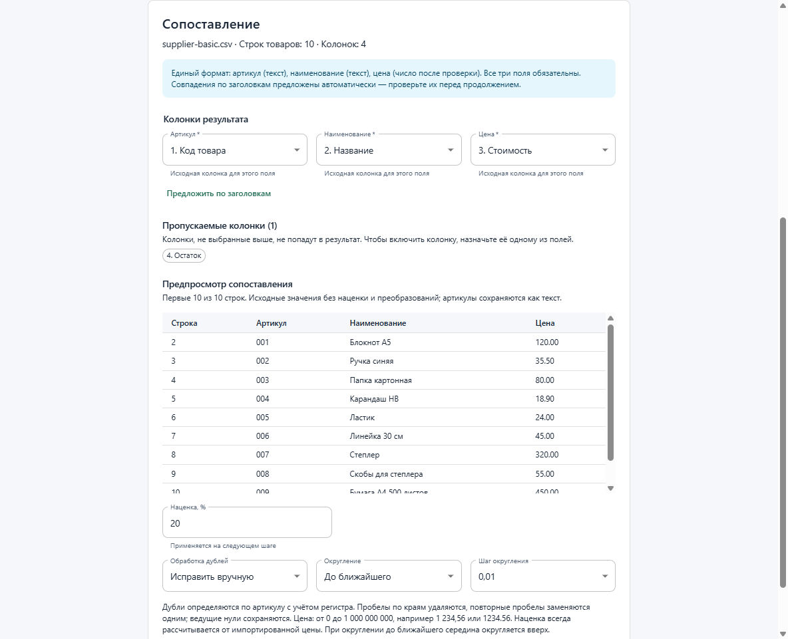

# Price List

Локальное приложение для магазина, который получает CSV/XLSX от разных
поставщиков и вручную приводит их к единому прайсу. Price List сопоставляет
колонки, находит ошибки и дубли, рассчитывает наценку и сохраняет готовый файл.
Стек: Electron + React + TypeScript (`strict: true`), Material UI.

Файлы обрабатываются на компьютере пользователя. Для установленного приложения
не нужны Node.js, Excel, аккаунт или подключение к сети.



## Попробовать за несколько минут

1. Установите `release/Price-List-1.0.0-x64-Setup.exe` или запустите проект по
   инструкции разработки ниже.
2. Откройте `samples/csv/supplier-basic.csv`: UTF-8, запятая, строка заголовков 1.
3. Сопоставьте «Код товара» → «Артикул», «Название» → «Наименование»,
   «Стоимость» → «Цена». Колонка «Остаток» не попадает в результат.
4. Оставьте наценку 20%, округление до ближайшей копейки; проверьте 10 товаров.
5. Экспортируйте CSV или XLSX. У первого товара артикул `001`, цена `144.00`.
   Готовый пример для сравнения находится в `samples/output/`.

Приложение поддерживает ручное исправление артикулов дублей, выбор первой или
последней строки, фильтрацию отчёта и подтверждение пропуска исключённых строк.
Профили сохраняют параметры поставщика между запусками. Большие таблицы
обрабатываются в worker; интерфейс показывает прогресс и позволяет отменить задачу.

| Материал | Содержание |
| --- | --- |
| [Демонстрация](docs/demo.md) | GIF на 20 секунд, скриншоты и сценарий показа |
| [Инструкция пользователю](docs/user-guide.md) | Установка, импорт, ошибки, профили, экспорт и удаление |
| [Архитектура](docs/architecture.md) | Main/preload/renderer, IPC, worker и сохранность файлов |
| [Производительность](docs/performance.md) | Замеры с объёмом данных, системой и границами измерения |
| [Портфолио](docs/portfolio.md) | Задача магазина, реализация и применимые бизнес-задачи |
| [Релиз 1.0.0](docs/releases/1.0.0.md) | Состав комплекта, проверки и ограничения |
| [Примеры](samples/README.md) | Исходные таблицы и готовые прайсы |

## Разработка

Нужен Node.js 22.12+ (рекомендуется актуальный LTS) и npm.

```sh
npm ci
npm run dev
```

`dev` запускает Electron и сервер Vite: изменения React обновляются через HMR,
изменения main/preload отслеживаются electron-vite.

Если PowerShell сообщает об отсутствующем `npm-cli.js` при вызове `npm`,
используйте `npm.cmd` вместо `npm` (например, `npm.cmd run dev`).

## Команды

| Команда | Назначение |
| --- | --- |
| `npm run dev` | Запуск разработки |
| `npm run typecheck` | Строгая проверка TypeScript |
| `npm test` | Проверки валидации запросов, расчётов и CSV |
| `npm run test:smoke` | Сквозная проверка Electron: интерфейс, preload, IPC, экспорт и профили |
| `npm run test:performance` | Большие CSV/XLSX, бюджеты памяти/времени, виртуализация и подтверждение отмены |
| `npm run test:packaged` | Сборка и проверка настоящего Windows exe: CSV/XLSX, повторный импорт, перезапуск и профили |
| `npm run samples` | Создание XLSX-примеров и больших CSV/XLSX в `samples/` |
| `npm run icon` | Воссоздание собственной PNG/ICO иконки из исходника |
| `npm run demo:capture` | Реальные снимки UI и готовые CSV/XLSX; использует отдельные тестовые настройки |
| `npm run release:prepare` | Комплект существующего установщика, инструкции, примеров и SHA-256 в `release/` |
| `npm run build` | Проверка типов и production-сборка в `out/` |
| `npm start` | Запуск ранее собранной production-версии в Electron |
| `npm run pack` | Сборка приложения без установщика в `release/` |
| `npm run dist` | Сборка Windows x64 NSIS-установщика в `release/` |

Windows-установщик следует собирать на Windows. Первая упаковка может скачивать
Electron и инструменты electron-builder. Установщик —
`release/Price-List-1.0.0-x64-Setup.exe` (версия из `package.json`), приложение —
Price List, собственная иконка — `build/icon.ico`. Подпись сертификатом пока
не настроена. Удаление сохраняет профили и экспортированные файлы.
Сценарий проверки чистой Windows и границы автоматических проверок описаны
в [docs/windows-validation.md](docs/windows-validation.md). 27.10.2026 пройден
автоматический прогон установки, запуска, CSV/XLSX-экспорта и удаления в чистой
Windows Sandbox без сети и среды разработки. Результат и ограничения — в отчёте.

## Структура

- `src/main/main.ts` — главный процесс и создание окна.
- `src/preload/index.ts` — точка входа preload; собирается в CommonJS для sandbox.
- `src/renderer/` — HTML и React-интерфейс.
- Интерфейс использует Material UI (MUI) и Emotion; общая тема находится в
  `src/renderer/src/theme.ts`. Для оформления используются компоненты MUI и `sx`.
- `src/shared/api.ts` — общие контракты данных, API и имена IPC-каналов.
- `src/shared/mapping.ts` — подсказки по заголовкам, общая проверка сопоставления и выбор исходных значений.
- `src/main/ipc.ts` — обработчики IPC с проверкой отправителя и входных данных.
- `src/main/services/workflow.ts` — демонстрационный источник, обработка и сериализация CSV.
- `src/main/services/import-file.ts` — чтение CSV/XLSX и ограниченный предпросмотр.
- `src/main/services/export-file.ts` — XLSX, выбор расширения, безопасная запись файлов и сообщения об ошибках сохранения.
- `src/main/data-worker.ts` — хранение данных и выполнение тяжёлых операций.
- `src/main/worker-client.ts` — задачи, прогресс, отмена и остановка worker.
- `src/main/services/streaming.ts` — потоковое чтение CSV и запись CSV/XLSX.
- `src/main/services/profile-store.ts` — сохранение и проверка настроек и профилей поставщиков.
- `src/shared/profiles.ts` — проверка совместимости заголовков и восстановление сопоставления профиля.
- `electron.vite.config.ts` — сборка трёх частей приложения.
- `electron-builder.yml` — настройки упаковки и установщика.

TypeScript проверяет исходники с `strict: true` и `target: ESNext`;
JavaScript выпускает Vite с целями, подходящими для Electron.
`out/` и `release/` генерируются автоматически и не хранятся в Git.

## Импорт таблицы поставщика

Запустите приложение и нажмите «Выбрать CSV / XLSX…». Для CSV выберите разделитель
(запятая, точка с запятой или табуляция) и кодировку (UTF-8, Windows-1251 или UTF-16LE).
Для XLSX выберите лист. Укажите исходный номер строки заголовков и нажмите
«Показать предпросмотр». Для CSV это физическая строка начала записи, а не строка
внутри многострочного поля. Пустые строки товаров пропускаются, исходные номера
сохраняются для отчёта об ошибках.

Предпросмотр показывает имя файла, число товаров и колонок и первые 100 строк.
После изменения параметров старый предпросмотр сбрасывается: его нужно построить
заново. Перейдите к сопоставлению колонок, задайте наценку, проверьте результат
и сохраните CSV или XLSX. Обрабатываются все строки, а не только предпросмотр.
Демонстрационная таблица также доступна для проверки без файла.
При отмене системного диалога можно повторить сохранение. При ошибках в данных
экспорт заблокирован; можно вернуться к сопоставлению.

Renderer обращается к `window.api`; preload предоставляет только конкретные
методы. Main проверяет окно, основной фрейм, адрес страницы и параметры запросов.
Исходная таблица и результат хранятся в worker, а запросы используют их идентификаторы.
Путь экспорта выбирается системным диалогом в main.

Пустые, повреждённые, защищённые паролем XLSX и неподдерживаемые файлы отклоняются
с сообщением об ошибке. Лимиты: файл до 100 МиБ, до 500 000 исходных
записей, 256 колонок и 4 000 000 ячеек. Чтение и обработка выполняются в worker;
интерфейс получает ограниченные страницы и сводку результата.

Формулы XLSX не вычисляются: берётся сохранённый результат. При отсутствии
результата используется явный маркер `#NO_CACHED_RESULT`. В интерфейсе выводится
предупреждение о необходимости пересчёта файла. Текстовые артикулы сохраняются;
числовые артикулы с простым форматом `0000` сохраняют ведущие нули. Произвольные
пользовательские форматы Excel не воспроизводятся.

Настройки расчёта и именованные профили поставщиков сохраняются между запусками
в пользовательской папке приложения.

`test:smoke` открывает тестовое окно Electron и автоматически закрывает его.
Системные диалоги в тесте заменены ответами выбора CSV/XLSX, отмены и сохранения;
тестовые файлы и снимки интерфейса записываются в `out/tests/`. Проверяются выбор
листа, строки заголовков, разделителя, сброс предпросмотра и экспорт.

В `samples/csv/` и `samples/xlsx/` находятся примеры поставщиков, ошибок и дублей
с кириллицей и ведущими нулями. [Описание примеров](samples/README.md) содержит
параметры импорта и ожидаемые результаты. `npm run samples` дополнительно создаёт
CSV на 100 000/400 000 товаров и XLSX на 25 000 товаров в `samples/generated/`.
`npm test` проверяет чтение этих
файлов, кодировки, многострочные поля, ошибки формата и границу предпросмотра.
Для ExcelJS закреплена совместимая исправленная версия `uuid` через `overrides`.

## Сопоставление колонок

Единый результат содержит три обязательных поля в фиксированном порядке:
«Артикул» (строка), «Наименование» (строка), «Цена» (число после проверки).
Артикулы не преобразуются в числа, поэтому текст `000001` сохраняется при
сопоставлении, обработке и записи CSV.

При импорте предлагаются совпадения только по русским заголовкам:
например, «Код товара», «Название», «Стоимость».
Регистр, пробелы и знаки пунктуации нормализуются. Если совпадений нет или их
несколько, поле остаётся в состоянии «Не выбрано» — нужно выбрать колонку вручную.
Одинаковые заголовки различаются номерами колонок. Кнопка «Предложить по заголовкам»
повторно применяет подсказки и заменяет текущий выбор.

Для каждого поля выберите отдельную исходную колонку. Ошибки показываются рядом
с полями и блокируют продолжение; main повторно проверяет сопоставление через IPC.
Колонки, не назначенные ни одному полю, перечисляются в разделе «Пропускаемые
колонки» и не включаются в итоговый прайс.

Предпросмотр сопоставления обновляется при выборе колонок и показывает первые
20 строк с исходными номерами, значениями и ведущими нулями. На этом шаге цена
ещё не преобразуется и наценка не применяется. «Не выбрано» означает отсутствие
назначенной колонки, «Пусто» — пустую ячейку выбранной колонки. Изменение
сопоставления сбрасывает рассчитанный результат; при новом импорте подсказки
строятся заново. Для выбранного профиля сопоставление восстанавливается по сохранённым
заголовкам с проверкой совместимости.

## Проверка данных и расчёт цены

Артикул и наименование очищаются от пробелов по краям; последовательности
пробельных символов (включая неразрывные) заменяются одним пробелом. Регистр и
ведущие нули артикула сохраняются. Ключ дубля — нормализованный артикул с учётом
регистра; название и цена в ключ не входят.

Цена обязательна: допустимы значения от 0 до 1 000 000 000 включительно,
с точкой или запятой и максимум двумя десятичными знаками. Разряды можно
разделять группами из трёх цифр через обычный, неразрывный или узкий неразрывный
пробел: например, `1 234,56`. Валютные обозначения, отрицательные значения,
экспоненциальная запись и смешанные разделители вроде `1,234.56` отклоняются.
Ошибки обязательных полей и цены указывают исходную строку и блокируют экспорт,
в том числе если ошибочная строка попала в исключаемые дубли.

Правило дублей выбирается на шаге сопоставления: оставить первую или последнюю
строку в исходном порядке либо исправить вручную (по умолчанию). Исключённые
номера строк перечисляются в предпросмотре. В ручном режиме измените артикулы
на шаге проверки и нажмите «Пересчитать исправления». Незавершённые исправления
блокируют экспорт. Изменение сопоставления или новый импорт сбрасывает исправления.

Наценка — от 0 до 1000%, максимум два десятичных знака. Итог округляется до
ближайшего значения, вверх или вниз с шагом 0,01, 1 или 10. Ровно посередине
округление до ближайшего идёт вверх. Расчёт выполняется в целых копейках через
BigInt с округлением только в конце. Предпросмотр показывает исходную цену,
цену с наценкой и номер строки. Повторный расчёт, изменение наценки и исправление
артикула всегда используют импортированную цену; наценка не накапливается.
Импортированная таблица остаётся неизменной; CSV и XLSX содержат только три
стандартных поля с итоговой ценой.

## Отчёт проверки

На шаге «Проверка» видны все обработанные строки, включая строки с ошибками.
Сводка считает строки, а не сообщения: три ошибки в одной строке увеличивают
счётчик ошибочных строк на один. «Корректные строки» — строки без блокирующих
ошибок, включая дубли, разрешённые правилом «первая/последняя».
«Строк в группах дублей» включает все строки группы, в том числе сохраняемую.
Отдельно показаны число исключённых строк, число сообщений об ошибках и
предупреждениях и число товаров, готовых к экспорту.

Для каждого сообщения указаны физический номер исходной строки, номер колонки
(с единицы), исходный заголовок, проверяемое значение и причина. Для артикула
проверяется значение с учётом ручного исправления. Предупреждения импорта,
которые относятся ко всему файлу, выводятся отдельно без вымышленных координат.

Фильтр позволяет выбрать все строки, ошибки, дубли, предупреждения, исключённые
строки или готовые товары. Таблица запрашивает страницы по 20, 50 или 200 строк;
изменение фильтра возвращает на первую страницу. Фильтры не изменяют результат.
Можно вернуться к сопоставлению, изменить настройки и пересчитать данные;
при ошибках в исходных ячейках исправьте файл и загрузите его заново.

Ошибки обязательных полей, цены и неразрешённые дубли блокируют экспорт прайса.
Разрешённые дубли и предупреждения импорта не блокируют его. Исключение дубля
не скрывает ошибки в его цене или обязательных полях: их всё равно нужно исправить.
На шаге экспорта перечислены первые 20 номеров исключённых строк и их общее число;
полный список доступен в фильтре «Исключённые». Сохранение доступно после
отметки «Подтверждаю пропуск исключённых строк». Main повторно проверяет ошибки,
идентификатор результата и подтверждение. После нового расчёта отметка сбрасывается.

«Сохранить отчёт CSV…» доступно и при ошибках в данных. Отчёт содержит все ошибки
и предупреждения текущего результата независимо от фильтра и страницы, включая
имя файла, координаты, поле, значение, уровень, причину и отметку об исключении.
Формат — UTF-8 с BOM и разделителем `;`; кавычки и переносы строк
экранируются, формулоподобные текстовые значения защищены префиксом апострофа.
Если сообщений нет, отчёт содержит только заголовки. Отмена диалога позволяет
повторить сохранение. При незавершённых ручных исправлениях нужно сначала
пересчитать результат, чтобы сохранить актуальный отчёт.

## Экспорт прайс-листа

На шаге «Экспорт» выберите CSV или XLSX и нажмите «Сохранить CSV…» либо
«Сохранить XLSX…». Системный диалог позволяет выбрать папку и имя файла;
фильтр и предлагаемое расширение соответствуют выбранному формату. Если
расширение не указано, оно добавляется автоматически. Несовпадающее расширение
отклоняется, чтобы содержимое XLSX не записалось в файл CSV и наоборот.
После успешной записи показаны полный путь, формат и количество сохранённых
товаров. Отмена и ошибка позволяют повторить сохранение без нового расчёта.

Оба формата используют одинаковый порядок: «Артикул», «Наименование», «Цена».
Экспортируются все готовые товары текущего результата, независимо от фильтра,
страницы отчёта и объёма предпросмотра. Проверки ошибок и подтверждения пропуска
исключённых строк действуют для обоих форматов.

CSV записывается в UTF-8 с BOM, разделитель — `;`, переносы
строк — CRLF. Все значения заключены в кавычки, внутренние кавычки удваиваются,
цены записываются с точкой и двумя десятичными знаками. Перед текстом, который
может быть интерпретирован как формула (включая ведущие пробелы и управляющие
символы), добавляется апостроф. CSV не хранит типы ячеек: Excel при прямом
открытии может преобразовать артикулы в числа. Для сохранения ведущих нулей
и длинных артикулов в Excel выбирайте XLSX либо импортируйте колонки CSV как текст.

В XLSX создаётся лист «Прайс-лист» с закреплённой строкой заголовков и фильтром.
Артикулы и наименования записываются строками с текстовым форматом `@`, цены —
числами с форматом `0.00`. Строки, начинающиеся с `=`, `+`, `-` или `@`,
остаются буквальным текстом без создания формул и добавления апострофа.
Текст длиннее 32 767 символов в ячейке XLSX отклоняется с указанием исходной
строки; можно сократить текст или выбрать CSV.

Полный файл сначала записывается во временный файл в той же папке, затем
заменяет выбранный файл после успешного закрытия. При ошибке записи или замены
прежний файл сохраняется, временный файл удаляется по возможности. Для занятого
файла, отсутствия прав, нехватки места и недоступной папки показаны сообщения
с действием для повторной попытки. Тот же способ записи используется для отчёта CSV.

Автоматические проверки открывают экспортированный XLSX через ExcelJS и оба
формата через импорт приложения, проверяют типы, ведущие нули, формулоподобный
текст и итоговые цены. Ошибки доступа, блокировки и частичной записи при
нехватке места моделируются в тестах. Сквозной тест Electron проверяет выбор
формата, диалог, отмену, повтор после ошибки, итог экспорта и загрузку готового XLSX.

## Профили поставщиков и настройки между запусками

Панель «Профили поставщиков» позволяет выбрать сохранённый профиль, создать новый,
обновить существующий, переименовать или удалить его. Для создания загрузите
таблицу, настройте сопоставление и расчёт, задайте название и нажмите «Сохранить
как новый». «Обновить профиль» заменяет настройки выбранного профиля. Названия
должны быть уникальными без учёта регистра, от 1 до 80 символов; допускается до
100 профилей. Удаление подтверждается в диалоге.

Профиль хранит формат источника, разделитель и кодировку CSV, строку заголовков,
имя листа XLSX, исходные заголовки и сопоставление, наценку, округление и правило
дублей. Заголовки и параметры импорта берутся в main из фактически загруженной
таблицы; renderer не передаёт путь к файлу настроек. Ручные исправления артикулов
относятся к конкретному импорту и не входят в профиль.

Выбор профиля очищает текущий импорт и результат. При открытии нового файла
применяются параметры выбранного профиля. Затем после предпросмотра сохранённые
заголовки ищутся в новом файле без учёта регистра и повторных пробелов, с Unicode-нормализацией.
Переставленные колонки сопоставляются по заголовкам. Отсутствующий или неоднозначный
заголовок оставляет соответствующее поле невыбранным: требуется ручное сопоставление.
Имена колонок не заменяются похожими по смыслу без выбора пользователя. Если формат
источника изменился, показано предупреждение; если сохранённый лист XLSX отсутствует,
нужно выбрать лист перед построением предпросмотра.

Профили являются явно сохранёнными наборами настроек: изменения сохраняются
кнопками создания/обновления. Последние параметры расчёта отдельно сохраняются при
нажатии «Проверить и рассчитать». При запуске восстанавливаются выбранный профиль
и последние параметры расчёта; повторный выбор профиля загружает именно сохранённые
в нём параметры. Без профиля используются стандартные параметры импорта и последние
сохранённые параметры расчёта.

Файл `profiles.json` хранится в каталоге Electron `app.getPath('userData')`
для текущего пользователя. Формат имеет поле `version: 1`; размер ограничен 4 МиБ.
Сохранения выполняются последовательно через временный файл и замену после успешной
записи. При ошибке остаются прежние настройки, а интерфейс показывает причину.

Повреждённый JSON или некорректные данные перемещаются в файл
`profiles.corrupt-<идентификатор>.json` в той же папке. Приложение показывает путь
резервной копии и запускается с настройками по умолчанию. Если копию создать
невозможно, сохранение отключается. Неподдерживаемая версия или ошибка чтения
также включает режим без сохранения и видимое предупреждение, сохраняя исходный
файл. Импорт, расчёт и экспорт продолжают работать с временными настройками.
После исправления доступа или восстановления совместимого файла перезапустите приложение.

`npm test` проверяет сохранение и восстановление, все действия с профилями,
совместимость заголовков, повреждения, версии, ошибки доступа и последовательные
записи. `npm run test:smoke` использует отдельные тестовые пользовательские папки:
создаёт и изменяет профили в одном процессе Electron, закрывает его и восстанавливает
выбор, параметры CSV, сопоставление и расчёт в новом процессе. Дополнительно
проверяются XLSX-листы, предупреждения и обработка с повреждённым либо несовместимым
файлом настроек. Тестовые данные находятся в `out/tests/`.

## Большие файлы, прогресс и отмена

Чтение файла, разбор CSV/XLSX, проверка данных, расчёт цен, подготовка отчёта и
экспорт выполняются в отдельном Node.js worker thread. Main обслуживает окно,
системные диалоги, настройки и проверяет запросы IPC. Полные таблицы и результаты
не пересылаются в renderer: импорт возвращает первые 100 строк, обработка — только
сводку. Остальные строки запрашиваются по идентификатору, смещению, фильтру и размеру
страницы (не более 200 строк). Проверки типов и актуальности идентификаторов остаются
в main и worker. После смены источника, профиля или отменённого расчёта старые
результаты недоступны.

CSV читается потоком по 64 КиБ с декодированием выбранной кодировки и сохранением
физических номеров строк, включая многострочные поля. CSV и отчёт записываются
порциями по 500 строк; XLSX экспортируется через потоковый writer ExcelJS с
периодическим освобождением цикла событий. Проверка и расчёт выполняются проходами
по данным с точками отмены каждые 500–1000 строк. XLSX при чтении пока загружается
полной книгой внутри worker: так сохраняются форматированные артикулы и результаты
формул. Для этой операции, как и для остальных, действуют ограничения файла,
числа строк/ячеек и лимит памяти worker.

Предпросмотр импорта запрашивается по 100 строк. Отчёт поддерживает страницы по
20, 50 и 200 строк; при больших страницах в DOM присутствует только видимое окно
строк и небольшой запас. Исходные и рассчитанные значения в предпросмотре
ограничены 1000 символами; полные значения используются при проверке и экспорте.
Сопоставление показывает первые 20 строк. Подтверждение исключений относится ко
всем исключённым строкам, а не только к отображаемой странице.

Панель прогресса показывает текущий этап, количество строк и процент, когда
объём известен. При чтении CSV процент определяется прочитанными байтами; общее
количество строк станет известно после разбора. При подготовке XLSX объём может
быть неизвестен — в этом случае отображается неопределённый прогресс.

Кнопка «Отменить операцию» открывает подтверждение «Остановить операцию?».
Остановка передаётся в worker через общий атомарный флаг и проверяется при чтении,
проверке и записи порций. Операции имеют отдельные идентификаторы; завершение
старой или отменённой задачи не применяется к новому импорту. Незавершённый
экспорт удаляет временный файл, прежний файл сохраняется. Отмена доступна до
начала окончательной замены файла; во время самой замены кнопка отключена.

Если сторонний XLSX-reader не отвечает на отмену в течение трёх секунд, worker
принудительно завершается, временный экспорт удаляется, данные и идентификаторы
сбрасываются. Нужно выбрать исходный файл снова. Worker также освобождается при
закрытии окна и смене профиля; исключения и превышение лимита памяти не блокируют
основной процесс. Одновременная тяжёлая задача отклоняется до завершения или отмены
текущей операции.

Новые ограничения: 100 МиБ на файл, 500 000 записей (включая заголовок), 256 колонок,
4 000 000 ячеек. Заголовок колонки — до 1000 символов; строка заголовков остаётся
в диапазоне 1–100 000. Полные данные остаются в памяти worker, поэтому это
ограниченная обработка больших файлов, а не загрузка произвольного объёма.

Для `npm run test:performance` заранее заданы следующие бюджеты:

| Набор и измерение | Бюджет |
| --- | --- |
| CSV, 100 000 товаров: чтение → расчёт → страница → экспорт | 10 секунд |
| XLSX, 25 000 товаров: чтение → расчёт → страница → экспорт | 15 секунд |
| Куча worker | 512 МиБ |
| RSS основного процесса вместе с worker | 900 МиБ |
| JS-куча main и renderer по отдельности | 128 МиБ |
| Максимальный интервал таймеров main и renderer при периоде 10 мс | 250 мс |

Замер 27.10.2026: CSV — 576 мс, XLSX — 382 мс; максимальный интервал таймера
main — 25 мс, renderer — 13.8 мс. Куча worker — до 113 МиБ, RSS main вместе
с worker — до 310 МиБ. Система, методика и исходный JSON опубликованы в
[отчёте](docs/performance.md). Это результаты конкретного окружения;
память и задержки измеряются выборочно. Новый запуск сохраняется в
`out/tests/performance.json` и не заменяет опубликованный отчёт автоматически.

Тест генерирует CSV на 100 000 и 400 000 строк и XLSX на 25 000 строк в `out/tests/`,
проверяет объём ответов IPC и число отрисованных строк, останавливает импорт через
диалог и обрабатывает новый файл после отмены. Модульные тесты дополнительно
проверяют отмену обработки и обоих форматов экспорта, удаление частичного файла,
отбрасывание устаревших результатов и принудительное завершение зависшего worker.
