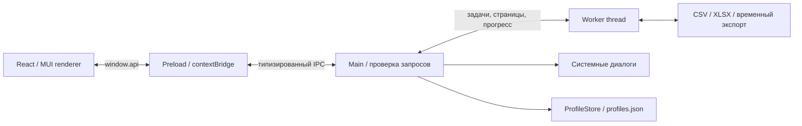

# Архитектура Price List

Приложение состоит из трёх сборок electron-vite и отдельной точки входа worker.
Контракт между частями определён в `src/shared/api.ts`; TypeScript работает с
`strict: true`. Renderer использует React, MUI с прямыми импортами компонентов и
Emotion. Файловая система доступна main и worker.

## Ответственность частей

| Часть | Код | Что делает |
| --- | --- | --- |
| Main | `src/main/main.ts`, `ipc.ts`, `validation.ts` | Создаёт окно, проверяет отправителя и параметры IPC, показывает диалоги, связывает задачи и профили |
| Preload | `src/preload/index.ts` | Публикует конкретные методы `window.api` через `contextBridge`; подписка на прогресс возвращает функцию отписки |
| Renderer | `src/renderer/src/` | Управляет шагами, сопоставлением, отчётом, профилями и подтверждением отмены; получает страницы таблицы |
| Worker | `src/main/data-worker.ts`, `worker-client.ts` | Хранит полные наборы данных, выполняет чтение, расчёт, фильтрацию и экспорт |
| Сервисы | `src/main/services/` | Разбор файлов, нормализация, точные расчёты, потоковая запись и хранение профилей |
| Общие типы | `src/shared/` | Контракты API, сопоставление русских заголовков и совместимость профилей |

## От выбора файла до экспорта

`openFile` показывает диалог в main и возвращает описание источника с ID.
`importTable` принимает ID и параметры чтения; worker оставляет полную таблицу
у себя, возвращая первые 100 строк и сводку. `importPage` отдаёт следующие страницы.
Сопоставление — индексы отдельных исходных колонок для артикула, наименования и цены.

`processTable` проверяет сопоставление и параметры расчёта. Цены преобразуются в
целые копейки и рассчитываются через BigInt, чтобы избежать накопления двоичной
погрешности. Дубли определяются по нормализованному артикулу с учётом регистра.
Расчёт всегда начинается с импортированных исходных цен. В renderer приходит
`ProcessView` со сводкой, а строки отчёта загружаются через `reportPage` с фильтром.
Максимум страницы — 200 строк; большие страницы отображаются виртуально.

`exportTable` повторно проверяет доступность результата, ошибки и подтверждение
исключений. Main получает путь через системный диалог, worker пишет файл во
временное назначение рядом с результатом. После успешной записи файл заменяется;
при ошибке или отмене временный файл удаляется. XLSX содержит текстовые артикулы
и числовые цены; CSV содержит BOM, разделитель `;` и защиту текстов от формул.

## IPC и изоляция

Renderer запускается с `contextIsolation: true`, `sandbox: true` и
`nodeIntegration: false`. Preload собирается в CommonJS для sandbox. Произвольный
`ipcRenderer`, путь к файлу или команды файловой системы в UI не публикуются.
Main проверяет окно, основной фрейм, URL отправителя и входные значения во время
выполнения: одних TypeScript-типов для IPC недостаточно. Ответ имеет форму
`{ ok: true, value }` или `{ ok: false, error }`.

Подсказки заголовков поддерживают только русские названия. У неоднозначного
сопоставления нет автоматического выбора. Навигация окна и создание новых окон
ограничены; production CSP не разрешает произвольное выполнение скриптов.

## Прогресс, отмена и память

`WorkerClient` сопоставляет сообщения с ID операции и отбрасывает устаревшие ответы.
Worker передаёт этап, число строк, процент при известном объёме и признак
доступности отмены. Пользователь подтверждает остановку; main выставляет атомарный
флаг в SharedArrayBuffer. Циклы чтения, обработки и записи проверяют его между
порциями. Финальная замена файла имеет отдельную фазу без отмены.

Если worker не реагирует три секунды, он завершается принудительно; старые ID
сбрасываются и источник нужно открыть снова. Закрытие окна освобождает worker.
CSV читается потоком по 64 КиБ; экспорт CSV/XLSX записывается порциями. XLSX
импортируется полной книгой внутри worker. Поэтому лимиты 100 МиБ, 500 000
исходных записей, 256 колонок, 4 млн ячеек и 512 МиБ кучи worker существенны.
Это не обработка таблиц произвольного размера с постоянным расходом памяти.

## Настройки и проверка

`ProfileStore` последовательно сохраняет версионированный `profiles.json` через
временный файл в `app.getPath('userData')`. Профиль содержит формат, параметры
импорта, заголовки, сопоставление и настройки расчёта. При новом импорте проверяется
совместимость заголовков. Повреждённый файл резервируется; будущая версия или
недоступный файл переводят сохранение в режим только чтения с предупреждением.

Модульные тесты проверяют правила и пограничные случаи; Electron smoke проверяет
UI → preload → main → worker. Отдельные запуски подтверждают восстановление
профилей, большие файлы и реальный упакованный EXE. Установка и удаление проверены
в чистой [Windows Sandbox](windows-validation.md).
