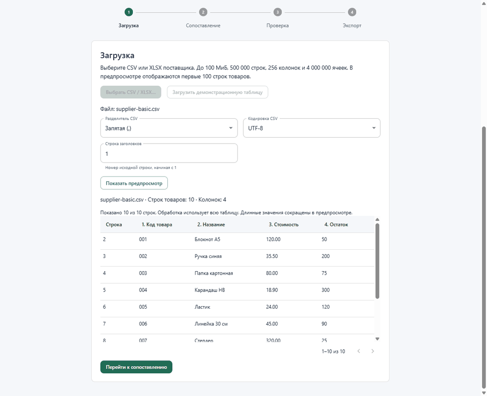

# Демонстрация



Это 20-секундная слайд-демонстрация из девяти реальных снимков приложения.
Паузы между кадрами заданы для чтения; это не запись времени выполнения задач.
Прогресс и отмена сняты во время настоящего импорта CSV на 400 000 товаров.
Нативные диалоги выбора файлов заменены тестовыми ответами; UI, IPC и worker
исполняются обычным кодом приложения с отдельным каталогом настроек.

| Кадр | Что демонстрирует |
| --- | --- |
| [1. Импорт](media/01-import.png) | CSV поставщика, параметры чтения и предпросмотр |
| [2. Сопоставление](media/02-mapping.png) | Русские заголовки, пропуск остатка, наценка 20% |
| [3. Проверка](media/03-result.png) | Исходная цена 120, итоговая 144, ведущие нули |
| [4. Экспорт](media/04-export.png) | Успешное сохранение готового прайса |
| [5. Ошибки](media/05-errors.png) | Исходные строки, дубли, блокировка экспорта |
| [6. Прогресс](media/06-progress.png) | Фоновый импорт большого CSV |
| [7. Подтверждение](media/07-cancel-confirmation.png) | Явная остановка задачи |
| [8. Отмена](media/08-canceled.png) | Сообщение о прекращении операции |
| [9. Восстановление](media/09-recovery.png) | Обычный импорт и расчёт после отмены |

## Повторить показ за 3–5 минут

Пройдите первый прайс из [инструкции](user-guide.md), затем откройте
`samples/csv/supplier-invalid.csv` и покажите причины ошибок. Для дублей отдельно
используйте `supplier-duplicates.csv`: при 20% первая строка даёт 12, последняя —
24; пропуск нужно подтвердить. Сохраните профиль и перезапустите приложение.
Завершите показ импортом `samples/generated/prices-400000.csv`, его отменой и
успешной обработкой небольшого файла. Большие примеры создаются `npm run samples`.

## Обновить материалы

```powershell
npm.cmd run demo:capture
python -m pip install Pillow
python scripts/create-demo-gif.py
```

Python и Pillow нужны только для сборки GIF. Первая команда создаёт девять PNG
в `docs/media/` и CSV/XLSX в `samples/output/`. Она пересоздаёт эти известные
артефакты, не использует настройки пользователя и проверяет успешную отмену и
обработку нового файла. После изменения UI просмотрите снимки перед публикацией.
